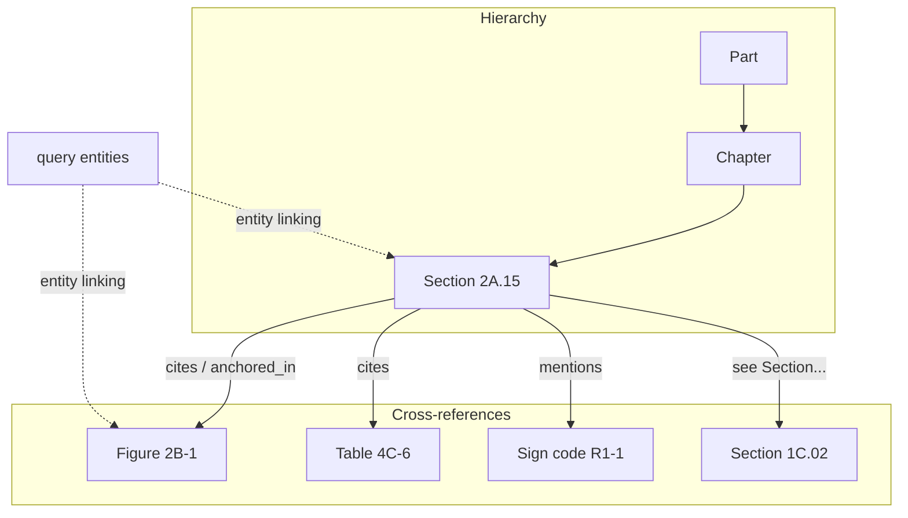
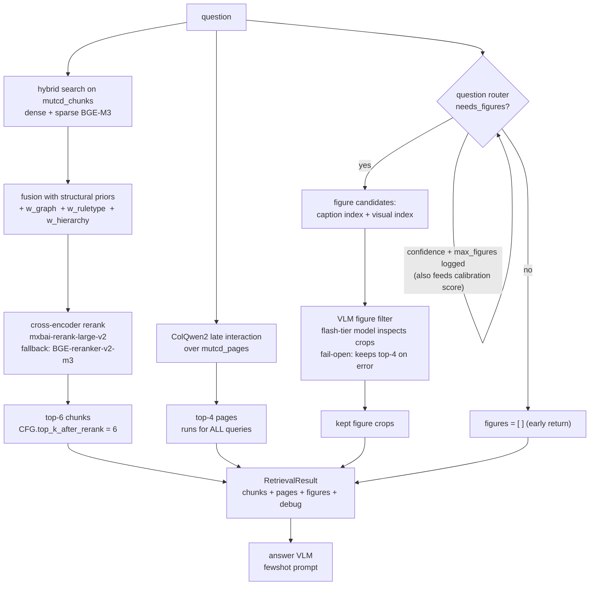
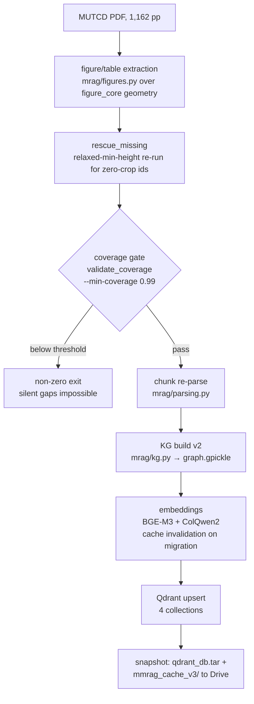
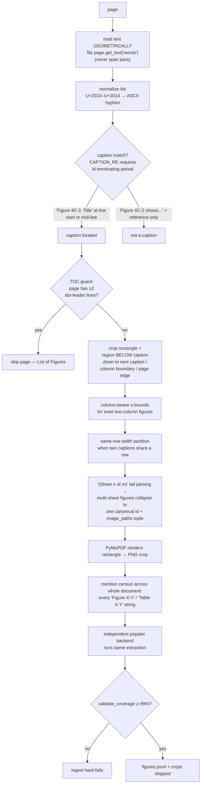

# GEMS-RAG: Complete System Architecture and Build Documentation

**Project:** Structure-aware multimodal RAG over the MUTCD 11th Edition
**Repository:** `github.com/hannanazad/gemsrag`
**Scope of this document:** full system design (what it is and how it works) and full build mechanics (which code built it, how, and where everything lives).

---

## Part I — System Design and Architecture

### 1. Design Thesis

GEMS-RAG is built over the MUTCD 11th Edition, a roughly 1,100-page federal standards manual mixing normative text, tables, figures, and sign diagrams. The core design bet: **a regulatory document is not a flat bag of paragraphs.** It has three explicit structures, and the system encodes all three at ingest time and exploits them at retrieval time, rather than relying on semantic similarity alone.

| structure | what it is in the MUTCD | how GEMS-RAG uses it |
|---|---|---|
| Hierarchy | Part → Chapter → Section | hierarchy prior (`w_hierarchy`) rewards retrieval candidates clustered in the same section neighborhood |
| Normative typology | every provision is a **Standard** (shall), **Guidance** (should), **Option** (may), or **Support** (informational) statement | rule-type weight (`w_ruletype`) favors provisions whose normative type fits the question; modal verbs extracted per chunk |
| Cross-reference web | sections citing figures, tables, sign codes, and other sections | knowledge graph edges; graph proximity prior (`w_graph`) boosts candidates graph-close to query entities |

### 2. High-Level Architecture

```
                    OFFLINE (ingest, once per document version)
 ┌──────────────────────────────────────────────────────────────────────┐
 │  MUTCD PDF (1,162 pp)                                                │
 │      │                                                               │
 │      ├─► provision-level chunking ──► 5,705 chunks ─┐                │
 │      ├─► figure/table cropping ────► 727 crop PNGs ─┤                │
 │      ├─► full-page rendering ──────► page images ───┤                │
 │      │                                              ▼                │
 │      │                                    embeddings (BGE-M3,        │
 │      │                                    ColQwen2)                  │
 │      │                                              │                │
 │      └─► knowledge graph (networkx) ─► graph.gpickle│                │
 │                                                     ▼                │
 │                                    Qdrant store (4 collections)      │
 └──────────────────────────────────────────────────────────────────────┘

                    ONLINE (per question)
 ┌──────────────────────────────────────────────────────────────────────┐
 │  question                                                            │
 │      │                                                               │
 │      ▼                                                               │
 │  question router (needs_figures? + confidence)                       │
 │      │                                                               │
 │      ├── text path: hybrid dense+sparse search                       │
 │      │       + structural priors (w_graph, w_ruletype, w_hierarchy)  │
 │      │       → cross-encoder rerank → top-6 chunks                   │
 │      │                                                               │
 │      ├── page path (always): ColQwen2 late interaction → top-4 pages │
 │      │                                                               │
 │      └── figure path (router-gated): caption + visual candidates     │
 │              → VLM figure filter → kept crops                        │
 │                                                                      │
 │  RetrievalResult { chunks, pages, figures, debug }                   │
 │      │                                                               │
 │      ▼                                                               │
 │  answer VLM (fewshot prompt) → Direct Answer + quotes + citations    │
 └──────────────────────────────────────────────────────────────────────┘
```

### 3. Document Processing and Extraction

The source PDF was parsed into **provision-level chunks** rather than fixed-size windows. Each chunk corresponds to one normative statement block within a section, and carries the structure with it.

A real chunk from the store:

| field | example value |
|---|---|
| chunk_id | `MUTCD11e_2A15_Standard_05` |
| part | Part 9 Traffic Control For Bicycle Facilities |
| chapter | Chapter 2A. General |
| section_id | 2A.15 |
| section_title | Mounting Height |
| content_type | Standard |
| ordinal | 5 |
| page_pdf / page_printed | anchors to both PDF page and printed page number |
| figure_refs / table_refs / section_refs | extracted cross-reference lists |
| sign_codes | e.g. R1-1 style codes mentioned in the provision |
| modal_verbs | shall / should / may occurrences |
| text | the provision text |

The modal verbs matter because in the MUTCD the words *shall*, *should*, and *may* are load-bearing: they define the legal force of a provision and map directly onto the Standard/Guidance/Option typology.

This extraction was rebuilt once (the v1-to-v2 extraction rebuild, detailed in Part II) and produced **5,705 chunks**.

In parallel, the visual layer was extracted twice over:

1. **Every page rendered to an image** (the page-image path used by ColQwen2 late-interaction retrieval).
2. **Figures and tables detected and cropped individually** with their captions and page anchors — around **485 figures** covered, 727 crop images total.

So a single visual asset exists both as a crop with metadata and as part of its full-page context.

### 4. Indexing — Four Doors to the Evidence

Everything lives in a local Qdrant store with four collections:

| collection | vector type | source model | contents |
|---|---|---|---|
| `mutcd_chunks` | dense 1024-d cosine **+** sparse lexical weights (two vectors per point) | BGE-M3 | 5,705 text chunks — enables hybrid dense+sparse search on one collection |
| `mutcd_figures` | dense 1024-d cosine | BGE-M3 | figure/table entries embedded from captions and metadata |
| `mutcd_pages` | 128-d multivector, max-sim comparator, **binary quantization (always_ram)** | ColQwen2 (ColPali-style late interaction) | full-page images |
| `mutcd_figures_visual` | 128-d multivector, max-sim comparator | ColQwen2 | figure crop images |

The practical effect: **a query can find evidence through four different doors** — what the text says, what the caption says, what the page looks like, and what the figure itself looks like.

### 5. The Knowledge Graph

Built from the extraction metadata and persisted as a pickle loaded with networkx.



**Nodes:** sections, figures, tables, sign codes.
**Edges, two sources:**
- the containment hierarchy (Part → Chapter → Section edges), and
- the extracted cross-references — a section that says "see Figure 2B-1" or "in accordance with Section 1C.02" gets an edge to that node.

**At query time** the system runs light entity linking over the question (the retrieval debug logs a `query_entities` list, so section IDs, sign codes, and figure names in the query get resolved to graph nodes). The graph then serves as a **retrieval prior rather than a separate answer path**: candidates that are graph-close to the query's entities or to other strong candidates get boosted. The proximity enters the fused score through a dedicated weight, `w_graph`.

> **Honesty note (recorded code audit, LE22):** the "graph expansion" step in `retrieval.py` is a stub — the KG **re-scores** dense candidates via `w_graph` but does **not** add new candidates to the pool. Any paper claim must say re-ranking, not retrieval expansion.

### 6. The Query-Time Pipeline



Stage detail, in order:

1. **Question router.** A lightweight classifier decides whether visual evidence is needed at all, emitting a decision, a confidence, and a figure budget. The debug shows entries like `needs_figures: False, confidence: 0.9, max_figures: 0`. That confidence is also what feeds the calibration term in the reliability score, which is why disabling the router makes the full composite undefined.
2. **Text retrieval** runs hybrid dense-plus-sparse search over the chunks and fuses the results with **three structural priors** added to the similarity signal: graph proximity (`w_graph`), a rule-type weight (`w_ruletype`) that favors provisions whose normative type fits the question, and a hierarchy prior (`w_hierarchy`) that rewards candidates clustered in the same section neighborhood.
3. **Rerank.** The fused top-K candidates go through a cross-encoder reranker, **mxbai-rerank-large-v2** (with a BGE-reranker fallback), which rescores query-document pairs and keeps the **top 6 chunks**.
4. **Page retrieval** runs alongside: ColQwen2 late-interaction search over page images returns the **top 4 pages regardless of routing** (logs show pages retrieved even for textual questions).
5. **Figure retrieval,** only if the router asked for figures: candidate crops are gathered through **both** the caption index and the visual index, then pass through the **VLM figure filter** — a cheap flash-tier vision model looks at each candidate crop against the question and discards irrelevant ones, with a **fail-open fallback** that keeps the top 4 unfiltered if the filter errors.
6. Everything is packaged into a `RetrievalResult` with exactly four fields: `chunks`, `pages`, `figures`, `debug`.

### 7. Answer Generation

The answer model is a vision-language model chosen from a **multi-provider harness** — Anthropic, Google, and Alibaba backends across three capability tiers, **twelve configurations total** — receiving:

- the question,
- the six reranked chunks,
- the four page images,
- the filtered figure crops,

under a **few-shot prompt**. The prompt enforces the output discipline seen in every run:

1. a **Direct Answer**,
2. verbatim **Standard** and **Support** quotations separated by normative status,
3. an explicit **visual-evidence statement**,
4. **citations localized** to section, provision, and page.

Claude Fable 5 in this harness was the configuration selected for in-depth analysis after winning the twelve-model comparison.

### 8. What the Ablations Proved About This Design

The leave-one-out study validated the design **asymmetrically**:

| component removed | finding |
|---|---|
| A6 — reranker | **The single most load-bearing component.** The only change with a confidence interval entirely below zero; hurts both retrieval and answers. |
| A2 — VLM figure filter | **A precision device.** Trades ~12 seconds of latency for roughly a threefold improvement in visual-crop precision. |
| A3 — graph prior, A4 — rule-type prior | Effects near the noise floor on end scores at N=150. |
| A5 — hierarchy prior | Specifically **protected strict completeness** (full-credit rate) while barely moving mean correctness. |
| A1 — question router | Earned its keep through **efficiency and calibration rather than correctness** (correctness slightly improved without it, because always-visual routing adds context). |

### 9. Known Caveats

1. The known weak spot is **context precision, sitting below 50 percent**, because sparse retrieval is degraded (the open fix is swapping the sparse leg or the embedder).
2. The fine-grained internals not restated here — the exact fusion arithmetic and KG edge weights — are **authoritative only in** `mrag/retrieval.py`, `mrag/vector_store.py`, and the KG-construction code, not in this summary.

---

## Part II — Build Mechanics and Code Map

### 10. Where the Code Lives

Everything is in the repo, `github.com/hannanazad/gemsrag`, split between the **`mrag/` package** (the system) and **`scripts/`** (the ingest orchestrators), driven by the notebooks in **`notebooks/`** (Colab).

```
gemsrag/
├── mrag/                        the system package
│   ├── figure_core.py           caption grammar + region geometry (NEW in v4)
│   ├── figures.py               extraction engine, dual backend (v1 archived)
│   ├── parsing.py               provision-level chunking
│   ├── kg.py                    knowledge graph v2 (v1 archived)
│   ├── embeddings.py            BGE-M3, ColQwen2, mxbai reranker
│   ├── vector_store.py          Qdrant wrapper, 4 collections, hybrid search
│   ├── question_router.py       deterministic router (NEW in v4)
│   ├── retrieval.py             Retriever: fusion, priors, rerank, pages
│   ├── vlm.py                   ALL prompts (P1 answer, P2 filter) + providers
│   ├── ask.py                   Pipeline, init_pipeline(), ask()
│   ├── config.py                CFG: every toggle the ablations flipped
│   ├── figures_v1_deprecated.py archived broken v1 extractor
│   └── kg_v1_deprecated.py      archived v1 graph builder
├── scripts/
│   ├── ingest_v4.py             current ingest orchestrator (NEW in v4)
│   └── ingest_v3.py             predecessor orchestrator
├── ablations/                   ablation study harness (separate docs)
├── docs/REBUILD_V4.md           v4 rebuild documentation
├── validation/                  census_records.jsonl + coverage_report.json
└── MUTCD_MRAG_HPRC.ipynb        main Colab driver notebook
```

### 11. Code Responsibility Map

| file | responsibility |
|---|---|
| `scripts/ingest_v4.py` | **The ingest orchestrator.** Runs the full chain: figure/table extraction → rescue pass → coverage gate (`--min-coverage 0.99`, exits non-zero on failure so a silent gap is impossible) → chunk re-parse → KG build → embedding + Qdrant upsert. Archives old caches as `*.bak`. Its predecessor `scripts/ingest_v3.py` did the earlier version. |
| `mrag/figure_core.py` | **The caption grammar and region geometry, backend-agnostic.** This is where the cropping *logic* lives: the crop-below rule, column-aware bounds, TOC guard, dash normalization, sheet parsing, and the mention census used for validation. |
| `mrag/figures.py` | **The extraction engine** that applies that geometry through two PDF backends: PyMuPDF (fitz) for production crops, poppler as an independent validation backend. Contains `rescue_missing()` and `validate_coverage()`. The broken v1 is archived as `figures_v1_deprecated.py`. |
| `mrag/parsing.py` | **Provision-level chunking of the text:** splits sections into Standard/Guidance/Option/Support blocks and extracts `figure_refs`, `table_refs`, `section_refs`, `sign_codes`, `modal_verbs` per chunk, with the same dash normalization. |
| `mrag/kg.py` | **Builds the knowledge graph** (v2; v1 archived as `kg_v1_deprecated.py`). One node per canonical figure/table id with an `image_paths` tuple for multi-sheet figures, and three-tier anchoring: `anchored_in` edges to citing sections (same-chapter preferred), falling back to `belongs_to_chapter` derived from the id, falling back to a weak `on_page_of` edge. Exposes `section_cites_figures()` which the router uses. |
| `mrag/embeddings.py` | **Loads the models:** BGE-M3 (dense 1024-d + sparse), ColQwen2 (128-d multivectors), and the mxbai reranker with its BGE cross-encoder fallback. |
| `mrag/vector_store.py` | **The Qdrant wrapper:** creates and searches the four collections, including `search_chunks_hybrid`. |
| `mrag/question_router.py` | **The deterministic router** (rules detailed in §16). |
| `mrag/retrieval.py` | **The `Retriever`:** hybrid fusion with the `w_graph`/`w_ruletype`/`w_hierarchy` priors, rerank to top-6, page retrieval for every query, figure paths gated on the router's decision. |
| `mrag/vlm.py` | **All prompts live here and only here:** P1 the answer prompt (zeroshot/oneshot/fewshot/cot styles) and P2 the figure filter, plus the multi-provider API clients. |
| `mrag/ask.py`, `mrag/config.py` | `init_pipeline()`, `ask()`, and the CFG object with every toggle the ablations flipped. |

### 12. Ingest Orchestration Flow



### 13. How Figures Were Actually Cropped (Deep Dive)

This was the hardest engineering problem in the project and it went through a full rewrite.

**The method: caption-anchored geometric cropping, no ML layout detection.**



**The v1 failure story.** The original v1 code assumed captions sit *below* their figures and cropped **above** each caption. The MUTCD puts **every caption above its content**, so v1:

- silently **dropped** figures whose captions sat at the top of a page (the missing-11 problem), and
- produced crops of the **previous** figure for mid-page captions (the wrong-crop problem).

The v4 rewrite inverted the rule and then handled the long tail of real-page pathologies:

| pathology | example | fix |
|---|---|---|
| inset two-column figures | caption mid-line in the text layer (Fig 2C-4) | column-aware x-bounds |
| side-by-side captions on one row | Tables 4C-6 / 4C-7 were zeroing each other's regions | width partitioning of the shared row |
| table-of-contents pages matching the caption pattern | List of Figures pages | page-level guard: skip pages with ≥2 dot-leader lines |
| multi-sheet figures | "(Sheet n of m)" markers at the end of titles | collapse into one canonical id holding a tuple of image paths |
| tiny tables under the minimum crop height | Table 2A-3 (~37 pt) | relaxed-minimum-height **rescue pass** for zero-crop ids |
| non-breaking hyphens in Rev-1 ids | "Table 6B‑2" with U+2011, invisible to ASCII regex | normalize U+2010–U+2014 → "-" at **every** id-matching point (captions, mentions, chunk refs, query parsing) |
| external references that look like tables | "Table 3-1 / 3-3" are AASHTO citations, not MUTCD tables | auto-excluded from the coverage census |
| body sentences mimicking captions | "Table 2C-1 may be used." at line start | CAPTION_RE **requires the id-terminating period** — true captions are always "Figure X-Y. Title" |

**The safety net that made it trustworthy:**

1. a **mention census** scans the entire document for every "Figure X-Y" and "Table X-Y" string,
2. the same extraction runs through the **independent poppler backend**, and
3. **`validate_coverage()` hard-fails the ingest below 99 percent coverage.**

That gate actually caught a real bug in production: fitz's span-joined text had encoding artifacts ("Figure4F-1." with the space glyph missing, "4F- 1" with the id split across glyph runs) that made **five 4F figures invisible** — which is why extraction was rebuilt on **geometric word segmentation** (`page.get_text("words")`), mirroring the validated poppler path, plus `canonicalize_ids()` to repair fused/split ids.

**Final validated state:**

| metric | value |
|---|---|
| figure coverage | **485 / 485 = 100.0%** |
| table coverage | **68 / 68 = 100.0%** |
| crop images | **727** (after junk purge from 743) |
| canonical ids | **553** |
| duplicates | **0** |
| previously-missing 11 figures | all confirmed extracted |
| external AASHTO refs (Table 3-1 / 3-3) | auto-excluded |

### 14. The Router's Actual Rules

`mrag/question_router.py` is fully deterministic, every fired rule logged into debug:

| stage | rule | effect |
|---|---|---|
| 1. hard-yes | explicit figure/table ids or visual verbs in the question | needs_figures = True immediately |
| 2. hard-no | definitional patterns with no visual evidence terms | needs_figures = False immediately |
| 3. soft score | sign codes | **+0.45** |
| | visual nouns | **+0.30** |
| | placement terms | **+0.15** |
| | textual markers | **−0.35** |
| | KG prior: fraction of matched sections that cite figures | **+0.35 × frac** |
| decision | score vs threshold | **0.5** |
| optional | VLM tie-break | off by default |

### 15. Where the Outputs Land

| location | contents |
|---|---|
| `mmrag_cache_v3/` (Drive) | `chunks.jsonl` (the 5,705 parsed chunks), `figures.jsonl` (crop metadata and bounding boxes), `graph.gpickle` (the KG), `sign_codes.json`, embedding caches: `chunks_dense.npy`, `chunks_sparse.json`, `figures_dense.npy`, per-figure ColQwen2 vectors under `colqwen_figures/<id>.npy` |
| `figures/` (Drive) | crop PNGs |
| `page_images/` (Drive) | full-page renders |
| `qdrant_db.tar` (Drive) | snapshot of the populated vector store — extracted into `/content/qdrant_db` each Colab session |
| `validation/` (repo) | `census_records.jsonl` (all 727 bounding boxes), `coverage_report.json` |
| `docs/REBUILD_V4.md` (repo) | the v4 rebuild documentation |

**Snapshot rule (recorded lesson):** a working restore needs **both** the Qdrant tar **and** the `mmrag_cache_v3/` folder — one without the other fails with FileNotFoundError or "Collection not found".

**Cache-invalidation rule (recorded lesson):** per-figure embedding caches are keyed by id (`colqwen_figures/<id>.npy`) and go stale **silently** when the underlying crop images change with ids unchanged — any figure re-extraction must delete the visual cache directory, and a chunk re-parse must also invalidate `chunks_dense.npy` / `chunks_sparse.json`.

### 16. Paper-Facing Honesty Notes

1. **Graph re-scores, does not expand** (LE22): the retrieval step-3 "graph expansion" is a stub — `w_graph` re-scores dense candidates only. Phrase graph claims as re-ranking, never retrieval expansion.
2. **Prompts have exactly one source of truth:** `mrag/vlm.py`. P1 = answer prompt (`CFG.prompt_style_answer`), P2 = figure filter (`CFG.prompt_style_filter`, zeroshot only).
3. **Context precision sits below 50%** because the sparse retrieval leg is degraded — the recorded open fix paths are pinning FlagEmbedding, patching the dtype kwarg, or swapping the embedder.
4. **Must-keep implementation details for the paper:** the caption-anchored crop-below method with the 485/485 census validation, and the LE22 caveat above.
