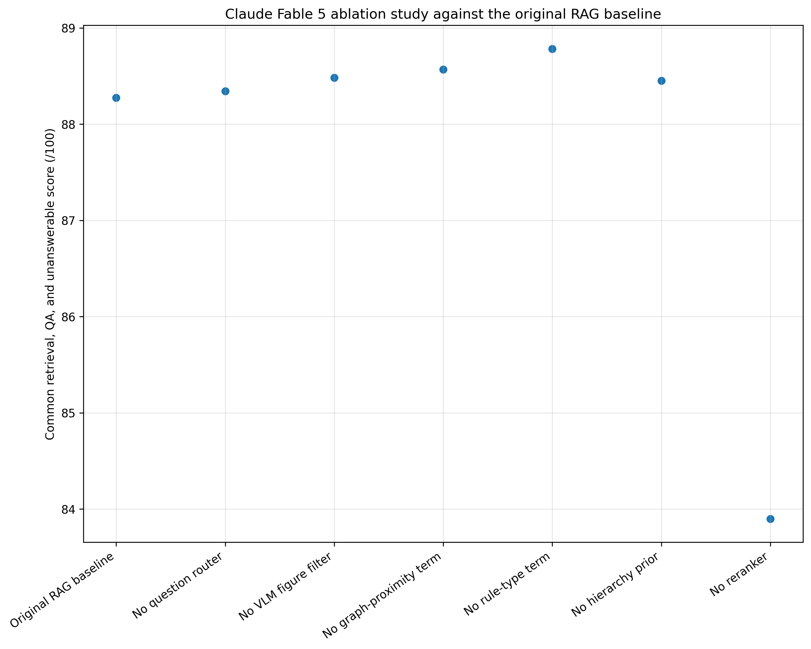
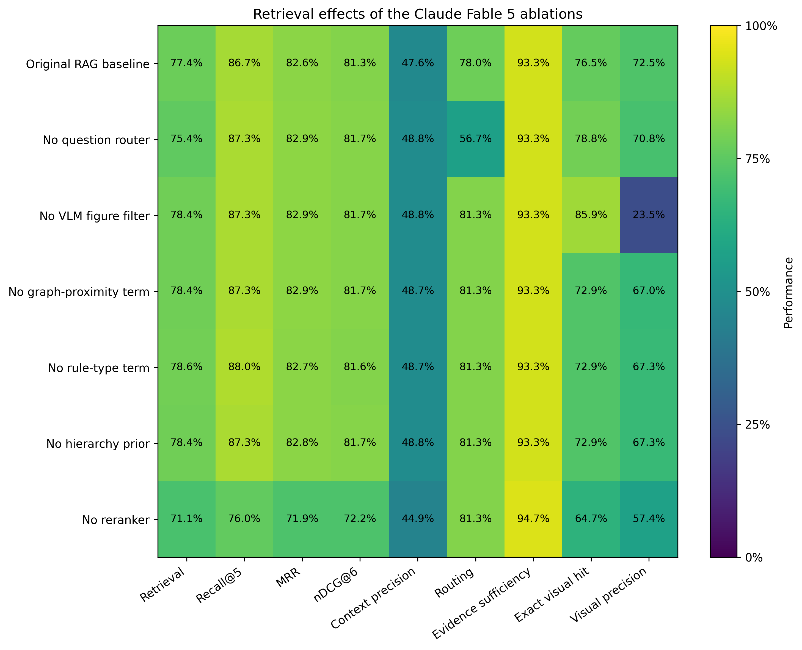
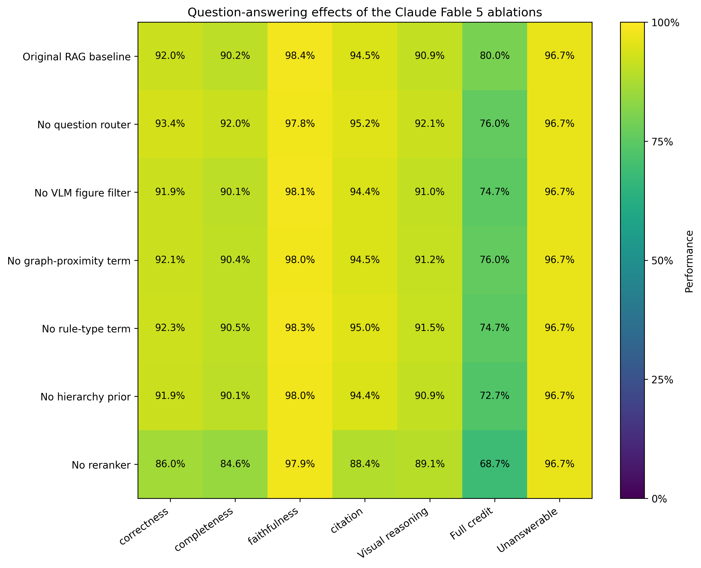
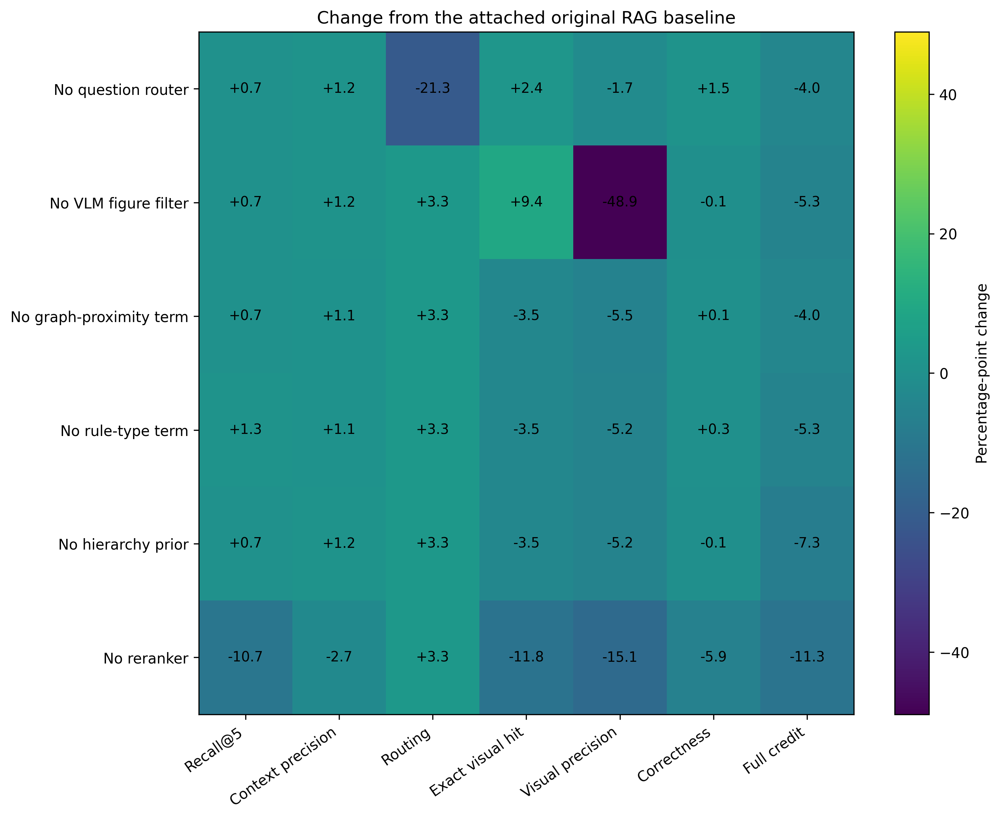
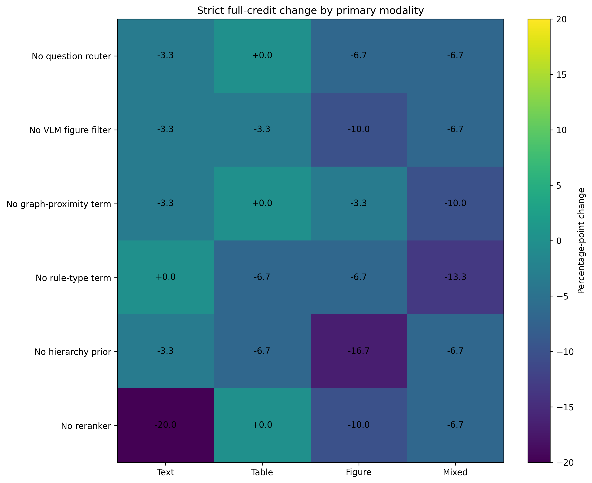

# MUTCD-150 Claude Fable 5 Ablation Study

## Study design

The study compares the attached original Claude Fable 5 RAG run with six updated component-removal runs. All runs used the `frontier_claude` alias, the few-shot prompt, the same 150 MUTCD-150 questions, and the locked M-SDI gold annotations. The updated runs used harness version `ablations_v3` and Git commit `ba26b07031398fb25efca8ba793a42c6ebb4ae03`.

The original RAG baseline is the canonical merged run `mutcd150_v9_frontier_claude_merged_adapterfix_final`. It achieved **88.08/100**, with **19.35/25** retrieval points, **55.18/60** generation points, and **10.90/12** currently measurable reliability points.

## Runtime and answer audit

All six updated archives contain 150 valid records. Each record includes six text chunks and four ranked page candidates. Every provider response ended with `end_turn`.

Answer comparison against the previous submission found:

- A2 through A6: **150/150 answers unchanged** in each archive;
- A1: **132/150 answers unchanged** and **18 repaired answers**, covering T001 through T018.

GPT-5.6 retained the prior adjudication for byte-identical answers and evaluated the 18 repaired A1 answers against the locked gold elements.

## Overall results

| Condition               |   Retrieval /25 |   Generation /60 | Reliability /12   | Full score /100   | Δ full score   |   Common score /100 | Correctness   | Completeness   | Citation   | Full credit   |   Median latency (s) |
|:------------------------|----------------:|-----------------:|:------------------|:------------------|:---------------|--------------------:|:--------------|:---------------|:-----------|:--------------|---------------------:|
| Original RAG baseline   |           19.35 |            55.18 | 10.90             | 88.08             | 0.00           |               88.27 | 92.0%         | 90.2%          | 94.5%      | 80.0%         |                28.41 |
| No question router      |           18.85 |            55.74 | N/A               | N/A               | N/A            |               88.34 | 93.4%         | 92.0%          | 95.2%      | 76.0%         |                29.89 |
| No VLM figure filter    |           19.59 |            55.12 | 10.70             | 88.06             | -0.01          |               88.48 | 91.9%         | 90.1%          | 94.4%      | 74.7%         |                16.64 |
| No graph-proximity term |           19.59 |            55.21 | 10.68             | 88.13             | 0.05           |               88.57 | 92.1%         | 90.4%          | 94.5%      | 76.0%         |                24.4  |
| No rule-type term       |           19.65 |            55.35 | 10.60             | 88.24             | 0.16           |               88.78 | 92.3%         | 90.5%          | 95.0%      | 74.7%         |                23.54 |
| No hierarchy prior      |           19.59 |            55.1  | 10.54             | 87.86             | -0.21          |               88.45 | 91.9%         | 90.1%          | 94.4%      | 72.7%         |                23.15 |
| No reranker             |           17.78 |            52.77 | 10.38             | 83.43             | -4.65          |               83.9  | 86.0%         | 84.6%          | 88.4%      | 68.7%         |                22.96 |

`Full score /100` uses the 97 measurable points: retrieval, generation, unanswerable handling, and calibration. A1 has no router confidence, so its calibration and full score are not defined. `Common score /100` uses a 91-point denominator that excludes calibration and repeatability and supports comparison across all seven conditions.

*Figure 1. Common 91-point score for the original RAG and all ablations.*

## Paired question bootstrap

| Condition               | Full-score change (95% CI)   | Common-score change (95% CI)   |
|:------------------------|:-----------------------------|:-------------------------------|
| No question router      | N/A                          | +0.07 [-0.56, +0.79]           |
| No VLM figure filter    | -0.01 [-0.43, +0.39]         | +0.21 [-0.07, +0.60]           |
| No graph-proximity term | +0.05 [-0.32, +0.44]         | +0.29 [+0.03, +0.66]           |
| No rule-type term       | +0.16 [-0.41, +0.83]         | +0.51 [+0.01, +1.17]           |
| No hierarchy prior      | -0.21 [-0.60, +0.19]         | +0.17 [-0.06, +0.53]           |
| No reranker             | -4.65 [-6.91, -2.60]         | -4.38 [-6.70, -2.31]           |

The intervals use 800 paired resamples of the 150 benchmark questions. They capture benchmark-sampling uncertainty, not model run-to-run variability. The no-reranker interval remains below zero. The intervals for the other completed ablations include zero.

## Retrieval and visual retrieval

| Condition               | Recall@5   | MRR   | nDCG@6   | Context precision   | Routing   | Evidence sufficiency   | Exact visual hit   | Visual precision   | Page hit@1   | Page hit@3   | Page hit@4   |
|:------------------------|:-----------|:------|:---------|:--------------------|:----------|:-----------------------|:-------------------|:-------------------|:-------------|:-------------|:-------------|
| Original RAG baseline   | 86.7%      | 82.6% | 81.3%    | 47.6%               | 78.0%     | 93.3%                  | 76.5%              | 72.5%              | 64.7%        | 88.2%        | 90.6%        |
| No question router      | 87.3%      | 82.9% | 81.7%    | 48.8%               | 56.7%     | 93.3%                  | 78.8%              | 70.8%              | 64.7%        | 88.2%        | 90.6%        |
| No VLM figure filter    | 87.3%      | 82.9% | 81.7%    | 48.8%               | 81.3%     | 93.3%                  | 85.9%              | 23.5%              | 64.7%        | 88.2%        | 90.6%        |
| No graph-proximity term | 87.3%      | 82.9% | 81.7%    | 48.7%               | 81.3%     | 93.3%                  | 72.9%              | 67.0%              | 64.7%        | 88.2%        | 90.6%        |
| No rule-type term       | 88.0%      | 82.7% | 81.6%    | 48.7%               | 81.3%     | 93.3%                  | 72.9%              | 67.3%              | 64.7%        | 88.2%        | 90.6%        |
| No hierarchy prior      | 87.3%      | 82.8% | 81.7%    | 48.8%               | 81.3%     | 93.3%                  | 72.9%              | 67.3%              | 64.7%        | 88.2%        | 90.6%        |
| No reranker             | 76.0%      | 71.9% | 72.2%    | 44.9%               | 81.3%     | 94.7%                  | 64.7%              | 57.4%              | 64.7%        | 88.2%        | 90.6%        |

*Figure 2. Retrieval and visual-retrieval performance.*

The reranker removal reduced Recall@5 to **76.0%** and the retrieval score to **17.78/25**. The no-filter condition recovered a required table or figure in **85.9%** of visual questions but reduced visual precision to **23.5%**. The filter therefore removed irrelevant visual evidence while preserving a smaller evidence set.

The no-router condition routed every question to the visual path. Its routing accuracy was **56.7%**, equal to the proportion of benchmark questions with a locked visual requirement. This condition cannot supply the router-confidence values required for calibration.

## Question answering and reliability

| Condition               | Correctness   | Completeness   | Faithfulness   | Citation   | Visual reasoning   | Full credit   | Unanswerable   | Brier   | ECE   |
|:------------------------|:--------------|:---------------|:---------------|:-----------|:-------------------|:--------------|:---------------|:--------|:------|
| Original RAG baseline   | 92.0%         | 90.2%          | 98.4%          | 94.5%      | 90.9%              | 80.0%         | 96.7%          | 0.169   | 0.130 |
| No question router      | 93.4%         | 92.0%          | 97.8%          | 95.2%      | 92.1%              | 76.0%         | 96.7%          | N/A     | N/A   |
| No VLM figure filter    | 91.9%         | 90.1%          | 98.1%          | 94.4%      | 91.0%              | 74.7%         | 96.7%          | 0.212   | 0.154 |
| No graph-proximity term | 92.1%         | 90.4%          | 98.0%          | 94.5%      | 91.2%              | 76.0%         | 96.7%          | 0.205   | 0.167 |
| No rule-type term       | 92.3%         | 90.5%          | 98.3%          | 95.0%      | 91.5%              | 74.7%         | 96.7%          | 0.220   | 0.180 |
| No hierarchy prior      | 91.9%         | 90.1%          | 98.0%          | 94.4%      | 90.9%              | 72.7%         | 96.7%          | 0.234   | 0.187 |
| No reranker             | 86.0%         | 84.6%          | 97.9%          | 88.4%      | 89.1%              | 68.7%         | 96.7%          | 0.250   | 0.225 |

*Figure 3. Question-answering and reliability measures.*

*Figure 4. Changes from the attached original RAG baseline.*

The no-reranker condition produced the largest losses in correctness, completeness, citation localization, and strict full credit. The no-hierarchy condition reduced full credit by **7.3 percentage points** while changing average correctness by only **0.1 points**. That pattern shows that the hierarchy prior mainly affected complete coverage of all required answer elements.

*Figure 5. Strict full-credit change by primary modality.*

## Paper interpretation

The reranker supplied the strongest measurable contribution. Removing it reduced both retrieval quality and final answer quality, and the paired question bootstrap kept the full-score reduction below zero.

The VLM figure filter traded some visual recall for a large gain in visual precision. The current composite score does not weight visual precision, so the no-filter configuration can appear competitive despite sending more irrelevant figures and tables.

The graph, rule-type, and hierarchy ablations produced small changes in mean scores. The hierarchy prior showed a clearer effect on strict completion than on average correctness. The graph and rule-type point estimates do not justify removal because their uncertainty intervals include zero and the study contains one generation run per condition.

## Limitations

1. The original RAG baseline predates the `ablations_v3` harness. Small baseline differences can reflect execution or logging changes as well as the removed component.
2. The study uses one generation run per condition. The paired bootstrap resamples questions but does not capture stochastic model variation.
3. GPT-5.6 performed the structured answer audit. A second MUTCD-informed annotator has not completed independent validation.
4. Repeatability remains pending.
5. Router confidence serves as the calibration signal. A1 cannot support the same calibration measure because it removes the router.
6. Visual precision is reported as a diagnostic metric and does not contribute directly to the 25-point retrieval score.
