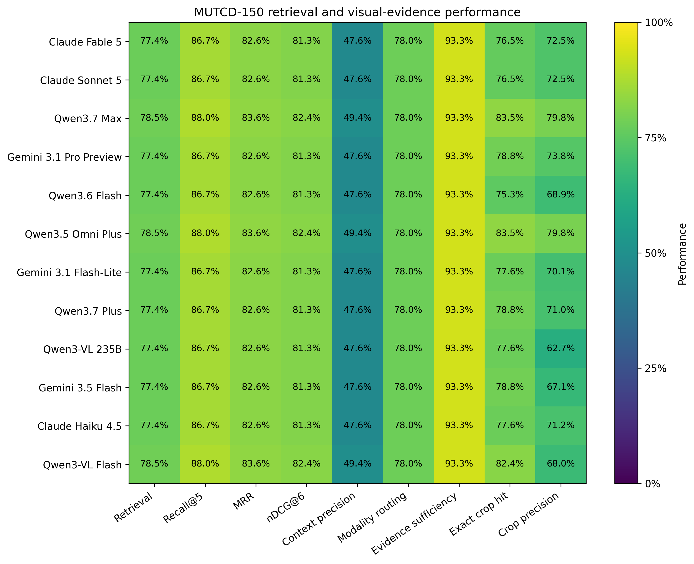
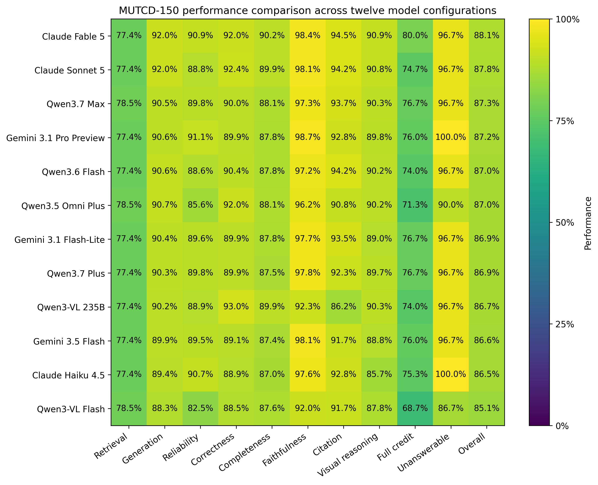
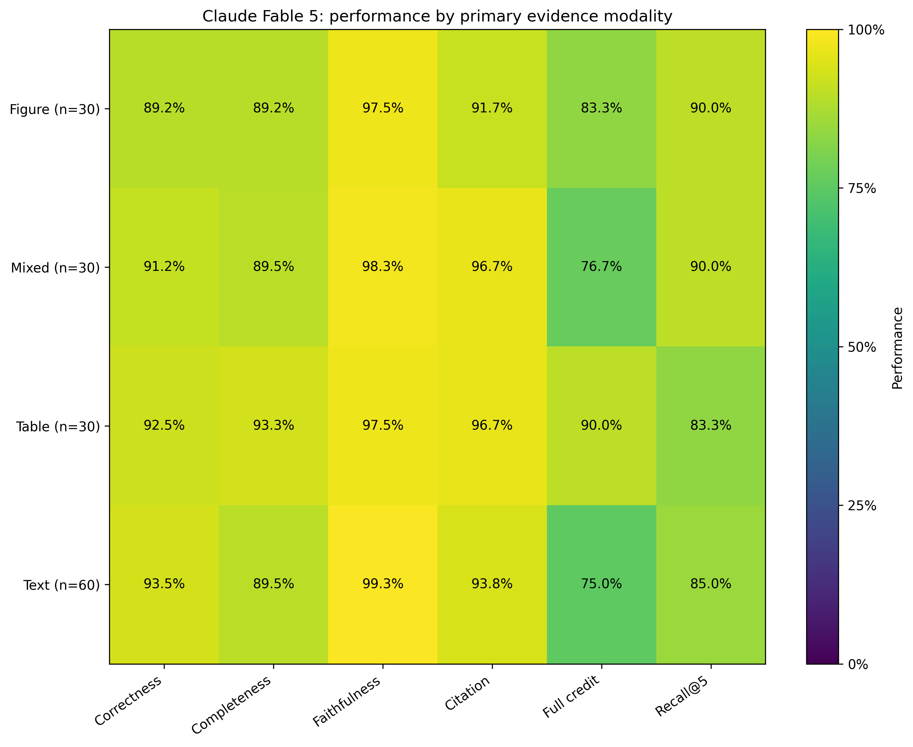
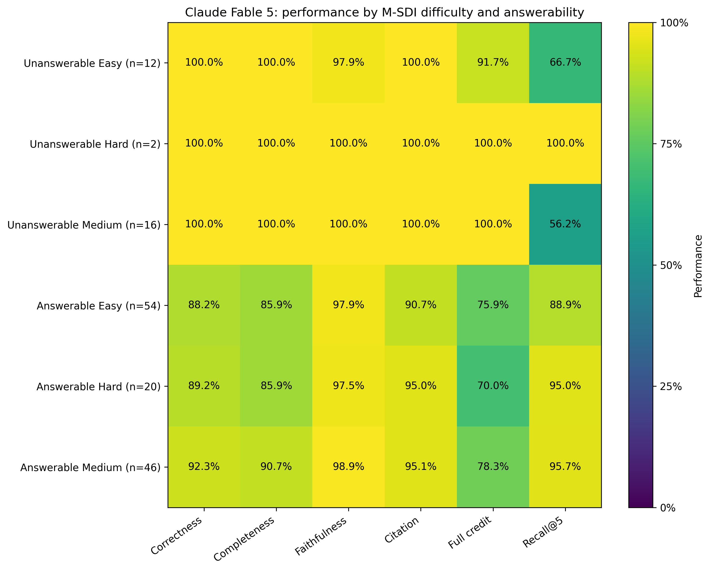
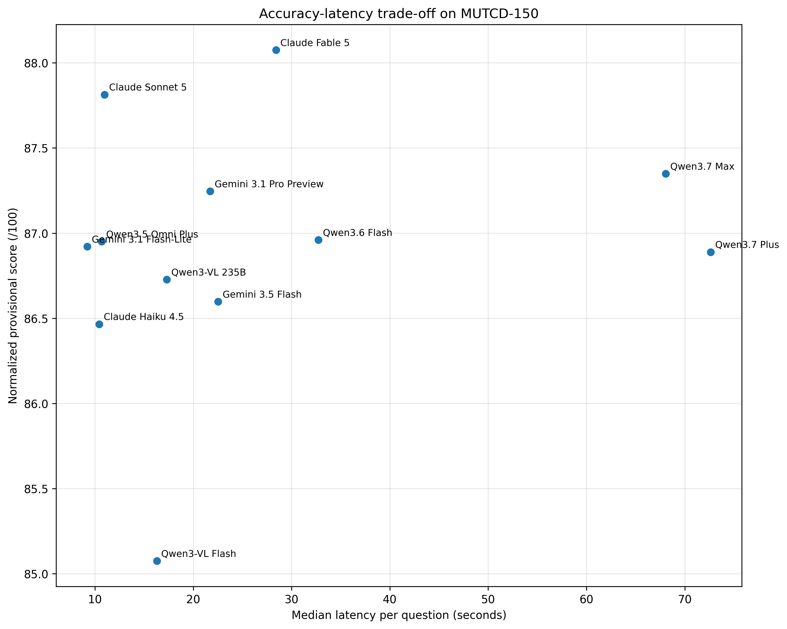

## Retrieval Performance

We evaluated retrieval against the sections, source pages, tables, and figures annotated for each MUTCD-150 item. We kept the text retriever, page retriever, reranker, benchmark questions, and evidence annotations fixed across the model runs. In each final run, we let the selected vision-language model handle figure filtering. We assigned 25 points to retrieval through Recall@5, mean reciprocal rank, nDCG@6, context precision@6, modality routing, and evidence sufficiency.

Across the twelve configurations, we recorded retrieval scores from 19.35 to 19.63 points, a range of 0.28 points. Recall@5 ranged from 86.7% to 88.0%, MRR from 82.6% to 83.6%, and nDCG@6 from 81.3% to 82.4%. Context precision ranged from 47.6% to 49.4%. The models made correct modality-routing decisions for 78.0% of the questions and retrieved sufficient evidence for 93.3%. We recomputed the Qwen3-VL 235B retrieval fields from its raw 150-record output using the same definitions applied to the other model runs.

On the 85 questions with a required table or figure, we found the required source page at rank 1 for 64.7% of the items, within the top three for 88.2%, and within the top four for 90.6%. We traced the larger model differences to the figure-filtering stage. We measured the highest exact visual-crop hit rate, 83.5%, for Qwen3.7 Max and Qwen3.5 Omni Plus. We measured 79.8% visual-crop precision for the same configurations. Across the models, exact-crop hit rates ranged from 75.3% to 83.5%, while visual-crop precision ranged from 62.7% to 79.8%.

**Table 1. Cross-model retrieval and visual-evidence performance.**

| Model                  |   Retrieval (/25) | Recall@5   | MRR   | nDCG@6   | Context precision@6   | Exact visual crop hit   | Visual crop precision   |
|:-----------------------|------------------:|:-----------|:------|:---------|:----------------------|:------------------------|:------------------------|
| Claude Fable 5         |             19.35 | 86.7%      | 82.6% | 81.3%    | 47.6%                 | 76.5%                   | 72.5%                   |
| Claude Sonnet 5        |             19.35 | 86.7%      | 82.6% | 81.3%    | 47.6%                 | 76.5%                   | 72.5%                   |
| Qwen3.7 Max            |             19.63 | 88.0%      | 83.6% | 82.4%    | 49.4%                 | 83.5%                   | 79.8%                   |
| Gemini 3.1 Pro Preview |             19.35 | 86.7%      | 82.6% | 81.3%    | 47.6%                 | 78.8%                   | 73.8%                   |
| Qwen3.6 Flash          |             19.35 | 86.7%      | 82.6% | 81.3%    | 47.6%                 | 75.3%                   | 68.9%                   |
| Qwen3.5 Omni Plus      |             19.63 | 88.0%      | 83.6% | 82.4%    | 49.4%                 | 83.5%                   | 79.8%                   |
| Gemini 3.1 Flash-Lite  |             19.35 | 86.7%      | 82.6% | 81.3%    | 47.6%                 | 77.6%                   | 70.1%                   |
| Qwen3.7 Plus           |             19.35 | 86.7%      | 82.6% | 81.3%    | 47.6%                 | 78.8%                   | 71.0%                   |
| Qwen3-VL 235B          |             19.35 | 86.7%      | 82.6% | 81.3%    | 47.6%                 | 77.6%                   | 62.7%                   |
| Gemini 3.5 Flash       |             19.35 | 86.7%      | 82.6% | 81.3%    | 47.6%                 | 78.8%                   | 67.1%                   |
| Claude Haiku 4.5       |             19.35 | 86.7%      | 82.6% | 81.3%    | 47.6%                 | 77.6%                   | 71.2%                   |
| Qwen3-VL Flash         |             19.63 | 88.0%      | 83.6% | 82.4%    | 49.4%                 | 82.4%                   | 68.0%                   |

*Figure 1. Cross-model retrieval and visual-evidence performance.*

We recovered required evidence at a high rate, but we also passed unrelated chunks and visual crops to the answer model. The context-precision values show this limitation: relevant material accounted for about half of the six reranked chunks. During the item audit, we linked several wrong or incomplete answers to a missing table row, a nearby figure, or a correct page without the required crop. We saw this pattern in questions about STOP-sign dimensions, Table 2C-3 distances, Figure 2A-3, Figure 2A-4, and Figure 2B-17.

In Table 1, we report the cross-model retrieval results; in Figure 1, we show the normalized retrieval measures. We attribute the narrow component-score range to the common retrieval stack. We use exact-crop hit and crop precision as the stronger diagnostic measures because the selected VLM controlled the final visual evidence set. We treat retrieval coverage and visual precision as separate requirements. High recall gave the models access to relevant evidence, while precise visual filtering reduced distraction in the answer prompt.

## Question Answering Results

We scored each response for factual and normative correctness, completeness, faithfulness to retrieved evidence, citation and evidence localization, and visual or table reasoning. We calculated a strict full-credit indicator that required scores of 1.0 for correctness, completeness, faithfulness, and citation quality. We used 97 measurable points for the current composite score because we have not completed the 3-point repeatability study. For the comparison in Table 2 and Figure 2, we normalized each current total by 97.

Across the twelve models, we recorded normalized scores from 85.08 to 88.08. We recorded the highest score for Claude Fable 5 at 88.08, followed by Claude Sonnet 5 at 87.81, Qwen3.7 Max at 87.35, and Gemini 3.1 Pro Preview at 87.25. We consider the 0.26-point gap between Fable and Sonnet too small to support a claim of statistical superiority before repeatability testing and independent annotation. We identify Fable as the best observed provisional configuration.

We gave Claude Fable 5 55.18 of 60 answer-generation points and 10.90 of 12 available reliability points. We measured 92.0% correctness, 90.2% completeness, 98.4% faithfulness, 94.5% citation localization, and 90.9% visual reasoning. We awarded strict full credit to 80.0% of its answers, the highest rate in the comparison. We measured the highest raw correctness for Qwen3-VL 235B at 93.0%, but we measured lower faithfulness at 92.3% and lower citation localization at 86.2%, which reduced its recalculated composite score to 86.73. For Gemini 3.1 Pro Preview, we measured 100% success on unanswerable questions and 98.7% faithfulness; omissions in quantitative and figure-based answers held its composite score at 87.25.

**Table 2. Cross-model question answering and latency results.**

| Model                  |   Overall score (/100) | Correctness   | Completeness   | Faithfulness   | Citation localization   | Full-credit rate   |   Median latency (s) |
|:-----------------------|-----------------------:|:--------------|:---------------|:---------------|:------------------------|:-------------------|---------------------:|
| Claude Fable 5         |                  88.08 | 92.0%         | 90.2%          | 98.4%          | 94.5%                   | 80.0%              |                28.41 |
| Claude Sonnet 5        |                  87.81 | 92.4%         | 89.9%          | 98.1%          | 94.2%                   | 74.7%              |                10.97 |
| Qwen3.7 Max            |                  87.35 | 90.0%         | 88.1%          | 97.3%          | 93.7%                   | 76.7%              |                68.07 |
| Gemini 3.1 Pro Preview |                  87.25 | 89.9%         | 87.8%          | 98.7%          | 92.8%                   | 76.0%              |                21.71 |
| Qwen3.6 Flash          |                  86.96 | 90.4%         | 87.8%          | 97.2%          | 94.2%                   | 74.0%              |                32.72 |
| Qwen3.5 Omni Plus      |                  86.95 | 92.0%         | 88.1%          | 96.2%          | 90.8%                   | 71.3%              |                10.67 |
| Gemini 3.1 Flash-Lite  |                  86.92 | 89.9%         | 87.8%          | 97.7%          | 93.5%                   | 76.7%              |                 9.21 |
| Qwen3.7 Plus           |                  86.89 | 89.9%         | 87.5%          | 97.8%          | 92.3%                   | 76.7%              |                72.64 |
| Qwen3-VL 235B          |                  86.73 | 93.0%         | 89.9%          | 92.3%          | 86.2%                   | 74.0%              |                17.31 |
| Gemini 3.5 Flash       |                  86.6  | 89.1%         | 87.4%          | 98.1%          | 91.7%                   | 76.0%              |                22.53 |
| Claude Haiku 4.5       |                  86.47 | 88.9%         | 87.0%          | 97.6%          | 92.8%                   | 75.3%              |                10.43 |
| Qwen3-VL Flash         |                  85.08 | 88.5%         | 87.6%          | 92.0%          | 91.7%                   | 68.7%              |                16.29 |

*Note: Overall scores are normalized from the 97 measurable points; the repeatability component remains pending.*

*Figure 2. Overall cross-model performance comparison.*

When we separated Claude Fable 5 by evidence modality, we awarded full credit to 90.0% of its table answers and 83.3% of its figure answers. On mixed questions, we measured 91.2% correctness, 89.5% completeness, and 76.7% full credit. On text questions, we measured 93.5% correctness and 99.3% faithfulness, but we awarded full credit to 75.0%. In many text responses, we found the governing rule without a complete definition, exception, quantity, or citation. For table questions, we obtained stronger full-credit results when retrieval supplied the exact row and dimensions. Table 3 and Figure 3 summarize these modality-specific results.

**Table 3. Claude Fable 5 performance by evidence modality.**

| Modality   |   n | Correctness   | Completeness   | Faithfulness   | Citation   | Full credit   |   Median latency (s) |
|:-----------|----:|:--------------|:---------------|:---------------|:-----------|:--------------|---------------------:|
| Figure     |  30 | 89.2%         | 89.2%          | 97.5%          | 91.7%      | 83.3%         |                29.69 |
| Mixed      |  30 | 91.2%         | 89.5%          | 98.3%          | 96.7%      | 76.7%         |                31.61 |
| Table      |  30 | 92.5%         | 93.3%          | 97.5%          | 96.7%      | 90.0%         |                30.31 |
| Text       |  60 | 93.5%         | 89.5%          | 99.3%          | 93.8%      | 75.0%         |                15.49 |

*Figure 3. Claude Fable 5 performance by primary evidence modality.*

We found no collapse on the M-SDI hard subset. On the 20 answerable hard items, we measured 89.2% correctness for Claude Fable 5, compared with 88.2% on answerable easy items and 92.3% on answerable medium items. We awarded full credit to 70.0% of the hard answers, 75.9% of the easy answers, and 78.3% of the medium answers. In the hard subset, we traced most losses to completeness and evidence localization. We often found the correct provision in the response, followed by an omitted threshold, exception, placement rule, or supporting citation. Table 4 and Figure 4 report the M-SDI breakdown.

**Table 4. Claude Fable 5 performance by M-SDI difficulty and answerability.**

| Group               |   n | Correctness   | Completeness   | Faithfulness   | Citation   | Full credit   |
|:--------------------|----:|:--------------|:---------------|:---------------|:-----------|:--------------|
| Unanswerable Easy   |  12 | 100.0%        | 100.0%         | 97.9%          | 100.0%     | 91.7%         |
| Unanswerable Hard   |   2 | 100.0%        | 100.0%         | 100.0%         | 100.0%     | 100.0%        |
| Unanswerable Medium |  16 | 100.0%        | 100.0%         | 100.0%         | 100.0%     | 100.0%        |
| Answerable Easy     |  54 | 88.2%         | 85.9%          | 97.9%          | 90.7%      | 75.9%         |
| Answerable Hard     |  20 | 89.2%         | 85.9%          | 97.5%          | 95.0%      | 70.0%         |
| Answerable Medium   |  46 | 92.3%         | 90.7%          | 98.9%          | 95.1%      | 78.3%         |

*Figure 4. Claude Fable 5 performance by M-SDI difficulty and answerability.*

We measured large differences in response time. Gemini 3.1 Flash-Lite reached a median latency of 9.21 seconds and a normalized score of 86.92. Claude Sonnet 5 reached 87.81 with a median latency of 10.97 seconds. Claude Fable 5 required 28.41 seconds. Qwen3.7 Max and Qwen3.7 Plus required 68.07 and 72.64 seconds. We view Sonnet as the strongest score-latency option among the top-ranked configurations, while Fable produced the highest full-credit rate and composite score. Figure 5 plots the score-latency trade-off.

*Figure 5. Normalized provisional score and median latency across the twelve model configurations.*

During the item audit, we concentrated the remaining errors in a small set of tasks. We found unsupported abstentions, missing numerical thresholds, and confusion between a requested figure element and a nearby annotation. Claude Fable 5 still missed all-way-stop volume thresholds, pavement-marking colors, STOP-sign dimensions, Table 2C-3 distances, the island-nose dimension in Figure 2A-3, and selected sign-identification questions. In a standards application, engineers can change a decision when a response omits one condition or quantity. We use the multidimensional scores and the strict full-credit rate alongside the composite ranking for that reason.
